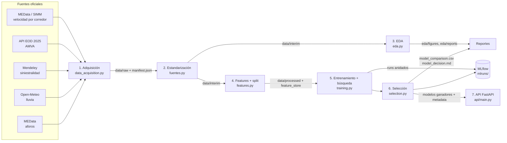
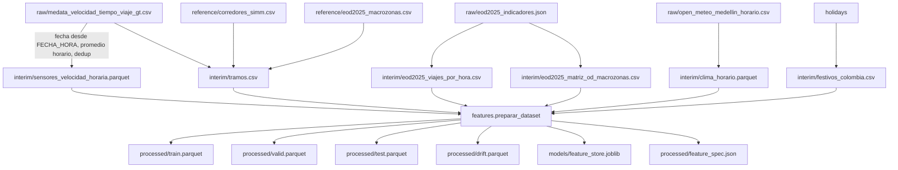

# MobiPredict — Informe técnico detallado

Este documento explica **cómo funciona el proyecto de punta a punta**: qué problema resuelve, de dónde salen los datos y cómo se construyeron, qué hace cada módulo, cómo se entrena y elige el modelo, y cómo se sirve. Para instalar y ejecutar rápido, ver [`README.md`](README.md).

---

## Índice

1. [Resumen](#1-resumen)
2. [Qué predice el sistema](#2-qué-predice-el-sistema)
3. [Arquitectura y flujo completo](#3-arquitectura-y-flujo-completo)
4. [Fuentes de datos: cómo se investigaron y eligieron](#4-fuentes-de-datos-cómo-se-investigaron-y-eligieron)
5. [Cómo se construyeron los datos, fuente por fuente](#5-cómo-se-construyeron-los-datos-fuente-por-fuente)
6. [Linaje de datos: de `raw` a `processed`](#6-linaje-de-datos-de-raw-a-processed)
7. [Análisis exploratorio (EDA)](#7-análisis-exploratorio-eda)
8. [Ingeniería de features](#8-ingeniería-de-features)
9. [Variables objetivo y definición de colapso](#9-variables-objetivo-y-definición-de-colapso)
10. [Partición temporal de los datos](#10-partición-temporal-de-los-datos)
11. [Modelos, búsqueda de hiperparámetros y validación cruzada](#11-modelos-búsqueda-de-hiperparámetros-y-validación-cruzada)
12. [Métricas](#12-métricas)
13. [Registro en MLflow](#13-registro-en-mlflow)
14. [Selección del modelo ganador](#14-selección-del-modelo-ganador)
15. [Orquestación con Prefect](#15-orquestación-con-prefect)
16. [API de predicción](#16-api-de-predicción)
17. [Contenedores](#17-contenedores)
18. [Pruebas automáticas](#18-pruebas-automáticas)
19. [Reproducibilidad y configuración](#19-reproducibilidad-y-configuración)
20. [Cómo actualizar con datos nuevos](#20-cómo-actualizar-con-datos-nuevos)
21. [Decisiones, supuestos y limitaciones](#21-decisiones-supuestos-y-limitaciones)
22. [Glosario](#22-glosario)

---

## 1. Resumen

MobiPredict es un sistema de Machine Learning con ciclo MLOps completo para la movilidad del Valle de Aburrá. Con datos abiertos y reales:

- **Pronostica la velocidad** de 22 tramos viales de Medellín una hora adelante (y de ahí el tiempo de viaje).
- **Alerta de colapso**: estima la probabilidad de que un tramo caiga por debajo del 50 % de su velocidad de referencia en la próxima hora.
- **Caracteriza la demanda y la densidad** de viajes con la Encuesta Origen-Destino 2025 del AMVA (6.490.299 viajes en un día hábil, matriz OD de 67 macrozonas).

Todo el flujo se ejecuta con un solo comando (`python run_pipeline.py`):

1. Descarga las fuentes oficiales.
2. Las valida y estandariza.
3. Genera el EDA.
4. Construye las features.
5. Entrena y optimiza nueve modelos.
6. Los registra en MLflow.
7. Elige los ganadores con reglas explícitas.
8. Deja todo listo para la API FastAPI.

**No se usan datos simulados en ningún punto.** Si una fuente obligatoria no está disponible, el pipeline se detiene con un error claro.

---

## 2. Qué predice el sistema

| Tarea | Tipo | Entrada | Salida | Para qué sirve |
| --- | --- | --- | --- | --- |
| Velocidad a 1 hora | Regresión | Últimas 4 lecturas horarias del tramo + contexto (hora, día, lluvia, demanda EOD) | Velocidad media del tramo en la hora siguiente (km/h) y tiempo de viaje (min) | Informar tiempos de viaje y planear operación |
| Colapso a 1 hora | Clasificación binaria | Las mismas | Probabilidad de colapso, alerta sí/no y nivel (`normal`, `precaucion`, `colapso`) | Disparar alertas tempranas al centro de control |
| Demanda y densidad | Análisis descriptivo | EOD 2025 | Viajes por hora y modo, reparto modal, viajes generados/atraídos por macrozona | Planeación; además alimenta el modelo como feature |

**¿Por qué velocidad y no flujo vehicular?** La Alcaldía no publica conteos de vehículos abiertos y continuos para varios años. La serie abierta más larga y consistente es la de **velocidad y tiempo de viaje por corredor** (2017-2020). La velocidad es además la variable que mejor describe la congestión: el flujo puede ser igual en vía libre y en congestión, la velocidad no.

---

## 3. Arquitectura y flujo completo



Las etapas 1 a 6 son `@task` de un `@flow` de Prefect (`src/mobipredict/pipeline.py`). La API corre aparte y carga lo que la etapa 6 deja en `models/`.

| # | Etapa | Módulo | Lee | Escribe |
| --- | --- | --- | --- | --- |
| 1 | Adquisición | `data_acquisition.py` | URLs oficiales o `data/raw/` | `data/raw/*`, `data/raw/manifest.json` |
| 2 | Estandarización | `fuentes.py` | `data/raw/*`, `data/reference/*` | `data/interim/*` (parquet/csv) |
| 3 | EDA | `eda.py` | `data/interim/*` | `eda/figures/*.png`, `eda/reports/*` |
| 4 | Features y split | `features.py` | `data/interim/*` | `data/processed/{train,valid,test,drift}.parquet`, `feature_spec.json`, `models/feature_store.joblib` |
| 5 | Entrenamiento | `training.py` | `data/processed/*` | `models/candidatos/*.joblib`, runs en `mlruns/` |
| 6 | Selección | `selection.py` | resultados de la etapa 5 | `models/modelo_velocidad.joblib`, `models/modelo_colapso.joblib`, `models/metadata.json`, `models/model_comparison.csv`, `docs/model_decision.md`, Model Registry |
| — | Servicio | `api/main.py` | `models/*` | Respuestas HTTP |

Toda la configuración (URLs, rutas, fechas de corte, umbrales, tamaños de búsqueda) está centralizada en `src/mobipredict/config.py`.

---

## 4. Fuentes de datos: cómo se investigaron y eligieron

### 4.1 Proceso de investigación

1. **Inventario.** Se buscaron en el catálogo nacional (datos.gov.co), en MEData (portal de la Alcaldía de Medellín), en el portal del AMVA, en el visor de la EOD 2025, en repositorios científicos y en servicios climáticos abiertos.
2. **Ubicación del archivo real.** Muchas fichas de datos.gov.co son "tableros" que apuntan a MEData. Se leyeron los metadatos de cada ficha (`/api/views/{id}.json`) para obtener la URL directa del CSV en MEData.
3. **Verificación completa, no por muestra.** Cada archivo candidato se leyó de principio a fin para medir:
   - filas totales;
   - rango real de fechas, contando por año-mes;
   - corredores, sentidos y horas cubiertas;
   - duplicados;
   - coherencia entre la fecha y el día de la semana.
4. **Decisión.** Se eligió cada fuente por cobertura temporal, consistencia y relación con el objetivo, no por lo que dice su descripción.

### 4.2 Fuentes elegidas

| # | Fuente | Publica | Uso | Cobertura verificada | Licencia |
| --- | --- | --- | --- | --- | --- |
| 1 | [Velocidad y tiempo de viaje GT](https://www.datos.gov.co/d/7t5n-3b3w) | Secretaría de Movilidad de Medellín (SIMM), vía MEData | **Serie del modelo** | 682.502 filas; 22 tramos (11 corredores × 2 sentidos); 6:00-20:00; 1-feb-2017 a 15-dic-2020; 1.045 días con datos | Datos abiertos de la Alcaldía |
| 2 | [EOD 2025 — API del visor oficial](https://eod2025.metropol.gov.co/) | AMVA | Demanda horaria, reparto modal, motorización, matriz OD | 42 indicadores + matriz OD de 3.126 pares (67 macrozonas) | Datos públicos del AMVA |
| 3 | [Road-traffic incidents and fatalities in Medellín 2008-2025](https://doi.org/10.17632/r6g5dfnpgh.1) | Correa Álvarez et al. (2026), Mendeley Data, con registros de la Secretaría de Movilidad | EDA de siniestralidad | 702.540 incidentes (2.762 fatales), 1-ene-2008 a 31-ago-2025 | CC BY 4.0 |
| 4 | [Open-Meteo Historical Weather API](https://open-meteo.com/en/docs/historical-weather-api) | Open-Meteo (reanálisis ERA5 / ERA5-Land de Copernicus) | Lluvia horaria como feature | Medellín (6,2442; −75,5812), 2017-2020 | CC BY 4.0 |
| 5 | [Aforos vehiculares](https://www.datos.gov.co/d/b9s9-jw7c) | Secretaría de Movilidad, vía MEData | Composición vehicular (EDA) | 74.900 registros de 15 min, 2017-2019, hasta 113 intersecciones; ≈ 40 % motos | Datos abiertos de la Alcaldía |
| 6 | Conteo vehicular Simmtrafficdata | Secretaría de Movilidad, vía MEData | Solo para ubicar los corredores | Cámaras CCTV/ARS con coordenadas WGS84, enero 2021 | Datos abiertos de la Alcaldía |
| 7 | Paquete `holidays` | Comunidad (Ley 51 de 1983) | Festivos de Colombia | 2017-2026 | MIT |
| 8 | Cifras publicadas | Observatorio de Movilidad y AMVA, vía El Colombiano | Referencias: [276 muertes en 2025](https://www.elcolombiano.com/medellin/balance-de-accidentalidad-en-medellin-el-ano-pasado-PF32374139); [+48 % motos y −14 % TP 2017-2025](https://www.elcolombiano.com/medellin/movilidad-habitantes-medellin-aburra-disminucion-teletrabajo-DD36063145) | 2025 | — |

El catálogo con URLs de descarga directa, tamaños y rutas locales está en [`data/fuentes_datos.csv`](data/fuentes_datos.csv).

### 4.3 Fuentes revisadas y descartadas

| Fuente | Por qué no se usó como base |
| --- | --- |
| Velocidad e intensidad vehicular (SIMM, CCTV/ARS) | Solo cubre julio-agosto de 2020 (431.490 filas), en plena pandemia: no representa operación normal |
| Conteo vehicular Simmtrafficdata (855 MB) | Solo enero de 2021, en temporada de vacaciones. Se usó únicamente para obtener la ubicación de las cámaras |
| Incidentes viales MEData | Llega a 2020. La base de Mendeley, con el mismo origen administrativo, llega a agosto de 2025 |
| Microdatos de la EOD (2017 o 2025) | El portal de datos abiertos del AMVA respondió 403. Se usaron los agregados oficiales de la API del visor, que incluyen la matriz OD |
| SIATA (lluvia por estación) | No ofrece API pública documentada para series históricas. Si se consigue, reemplaza a Open-Meteo sin tocar el modelo |

---

## 5. Cómo se construyeron los datos, fuente por fuente

### 5.1 Adquisición (`data_acquisition.py`)

Para cada fuente se sigue la misma lógica:

1. Si el archivo ya existe en `data/raw/` y no está vacío, se reutiliza (`origen = local:data/raw`).
2. Si no existe, se descarga de la URL oficial en `config.FUENTES`. Usa *streaming* a un archivo temporal `.part`, 3 intentos con espera creciente y renombra solo al terminar, para que una descarga cortada no deje un archivo corrupto.
3. Si la descarga falla y no hay archivo local:
   - **EOD 2025**: usa la copia oficial versionada en `data/reference/eod2025/`.
   - **Velocidad y clima** (obligatorias): el pipeline se detiene con `FuenteNoDisponible`.
   - **Siniestros y aforos** (opcionales): se registra el error y el EDA omite esas figuras.

Al final se escribe `data/raw/manifest.json` con, por cada fuente: título, URL, ficha, archivo, origen real, bytes y los primeros 16 caracteres del SHA-256. Así siempre se sabe con qué datos exactos se entrenó.

| Archivo en `data/raw/` | Fuente | Cómo se obtiene |
| --- | --- | --- |
| `medata_velocidad_tiempo_viaje_gt.csv` | MEData | Descarga directa del CSV |
| `medata_aforos_vehiculares.csv` | MEData | Descarga directa del CSV |
| `mendeley_siniestros_medellin_2008_2025.zip` | Mendeley | Descarga directa (redirige a S3) |
| `eod2025_indicadores.json` | API EOD 2025 | `GET /metadata/indicadores`; luego `GET /indicadores/{id}/agregado` por cada id, y el indicador 1 filtrado por cada municipio |
| `eod2025_macrozonas.geo.json` | Visor EOD 2025 | Descarga opcional de los polígonos |
| `open_meteo_medellin_horario.csv` | Open-Meteo | `GET /v1/archive` con `hourly=precipitation,temperature_2m` y `timezone=America/Bogota`. También acepta el `.json` que deja el script de PowerShell |

### 5.2 Velocidad por corredor (`fuentes.leer_velocidad_gt`, `fuentes.estandarizar_sensores`)

El CSV crudo tiene 20 columnas: `ID, FECHA_HORA, TV_[S], CORREDOR, DÍA, MES, AÑO, HORA, FECHA, NOMBRE_CORREDOR, Flujo_tipo, SENTIDO, INICIO, FIN, LONGITUD_KM, TV_MINUTOS, VELOCIDAD_KM/H, TV_MIN/KM, DIASEM, NOMBRE_DÍA`. Los datos provienen de tiempos de viaje de Google Traffic que la Alcaldía agrega por tramo completo.

**Problemas encontrados al leer el archivo completo y cómo se resolvieron:**

| # | Problema | Evidencia | Solución en el código |
| --- | --- | --- | --- |
| 1 | `DÍA` y `MES` no son confiables en parte de 2020 | `FECHA_HORA = 1/02/2020 6:00` aparece con `DÍA = 2`; al contar por la columna `MES`, febrero de 2020 tenía 871 filas por corredor (lo esperable son ~435) | La fecha se toma solo de `FECHA_HORA` con formato `%d/%m/%Y %H:%M`. Se verificó que coincide con `DIASEM` en el 100 % de las 682.502 filas. El código igual descarta cualquier fila incoherente |
| 2 | La resolución cambia | Antes de 2020 hay una lectura por hora; en 2020 hay lecturas a las :00 y a las :30 | `timestamp = floor(FECHA_HORA, hora)` y promedio por (tramo, hora). Toda la serie queda horaria |
| 3 | Duplicados | 9.699 claves (tramo, `FECHA_HORA`) repetidas | Se promedian en el mismo `groupby` |
| 4 | Identificador de corredor ambiguo | El ID 13/14 aparece a veces con Guayabal y a veces con El Poblado; `INICIO`/`FIN` y longitud cambian levemente (p. ej. Av. 80 entre Calle 65 o Calle 60) | El tramo se define por nombre del corredor + sentido (`AVENIDA_80_NS`). `inicio`/`fin` = moda; longitud = mediana |
| 5 | Codificación con caracteres dañados | Encabezados y `NOMBRE_DÍA` con `Mi�rcoles` | Lectura UTF-8 con reemplazo y columnas por posición, no por nombre |
| 6 | Valores físicamente imposibles | Velocidades extremas | Se descartan las lecturas fuera de 2-110 km/h y se registra cuántas |
| 7 | Sin datos nocturnos | Solo 6:00-20:00 | No se imputa: los rezagos no cruzan la noche (sección 8) |

**Salidas:**

- `data/interim/sensores_velocidad_horaria.parquet`: una fila por (`tramo_id`, `timestamp`), con `velocidad_kmh` y `tiempo_viaje_min`.
- `data/interim/tramos.csv`: catálogo de los 22 tramos.

| Columna de `tramos.csv` | Cómo se calcula |
| --- | --- |
| `tramo_id` | `NOMBRE_CORREDOR` normalizado + `SENTIDO` (p. ej. `AUTOPISTA_SUR_NS`) |
| `corredor`, `sentido`, `inicio`, `fin`, `flujo_tipo` | Moda de los registros del tramo |
| `longitud_km` | Mediana |
| `flujo_continuo` | 1 si `Flujo_tipo` es "Continuo" (autopistas, Regional, Las Palmas), 0 si es "Interrumpido" (semaforizado) |
| `lat`, `lon` | Ubicación media de las cámaras del SIMM del corredor (`data/reference/corredores_simm.csv`) |
| `id_macrozona`, `macrozona` | Macrozona EOD 2025 cuyo centroide está más cerca del tramo |

### 5.3 Ubicación de los corredores (`data/reference/corredores_simm.csv`)

La serie de velocidad no trae coordenadas. Para ubicar cada corredor se leyó completo el conjunto *Conteo Vehicular (Simmtrafficdata)* de MEData, cuya columna `LOCATION` trae `{'lon': ..., 'lat': ...}` en WGS84 por cámara. Se tomaron las cámaras únicas por corredor y se promediaron sus coordenadas. El corredor `San Juan` del SIMM se renombró `Avenida San Juan` para que casara con la serie de velocidad. El archivo guarda también el número de cámaras y el rango de latitudes, para ver qué tan extenso es el corredor.

### 5.4 EOD 2025 (`fuentes.estandarizar_eod`)

El visor oficial (`eod2025.metropol.gov.co`) se alimenta de una API JSON pública. Se identificaron sus rutas inspeccionando el tráfico de red del visor:

| Ruta | Contenido |
| --- | --- |
| `/api/api/metadata/indicadores` | Lista de ids de indicadores (1-46, sin 30, 40 y 41) |
| `/api/api/indicadores/{id}/agregado` | Valor o distribución del indicador. Acepta `?municipio=` |
| `/api/api/metadata/municipios` | Los 10 municipios |
| `/macrozonas_actualizado.geo.json` | Polígonos de las macrozonas |

Indicadores usados:

| Id | Indicador | Uso |
| --- | --- | --- |
| 1 | Total de viajes en un día hábil (6.490.299) | EDA |
| 2, 3 | % de personas que no viajan (31,6 %), tiempo promedio de viaje (39,3 min) | EDA |
| 12, 13 | Autos (67,1) y motos (120,5) por 1.000 habitantes | EDA |
| 15 | Matriz OD por macrozona (`agrupa_mz_origen`, `agrupa_mz_destino`, `valor`) | EDA (densidad) y features |
| 16-19 | Viajes por hora de inicio: informal, privado, público, no motorizado | EDA y features |
| 27 | Modo principal (% de viajes) | EDA |

**Diccionario de macrozonas.** La API identifica las macrozonas solo con números (1-67). La correspondencia número → municipio/macrozona está en el código del visor (objeto `Ii`). Se extrajo una vez y quedó versionada en `data/reference/eod2025_macrozonas.csv`. A cada macrozona se le calculó el centroide del polígono del GeoJSON (fórmula del centroide de un polígono plano). La macrozona 67 es "Sin especificar" y no tiene centroide.

**Copia de respaldo.** `data/reference/eod2025/indicadores_api.json` (42 indicadores) y `data/reference/eod2025/matriz_od_macrozonas.csv` (3.126 pares origen-destino) son una copia exacta de la API, extraída el 23-oct-2026. Se verificó que la matriz suma **6.490.299 viajes**, igual al indicador 1. Si la API no responde, `data_acquisition._eod_desde_referencia` arma el mismo JSON a partir de esta copia.

**Salidas:**

- `data/interim/eod2025_viajes_por_hora.csv`: 24 filas (horas 0-23) con `viajes_informal`, `viajes_privado`, `viajes_publico`, `viajes_no_motorizado`, `viajes_total` y su participación diaria (`share_*` = viajes de la hora / viajes del día).
- `data/interim/eod2025_matriz_od_macrozonas.csv`: `origen, destino, viajes`.
- En `features.py`, `priors_macrozona` agrega la matriz: viajes **generados** = suma por origen; viajes **atraídos** = suma por destino.

### 5.5 Clima (`fuentes.estandarizar_clima`)

Open-Meteo devuelve la serie horaria del reanálisis ERA5 para el punto central de Medellín, en hora local de Bogotá (la misma zona de la serie de velocidad, así se cruzan directo por `timestamp`). Los faltantes de lluvia se llenan con 0 y se recortan valores negativos.

Salida: `data/interim/clima_horario.parquet` (`timestamp`, `lluvia_mm`, `temperatura_c`).

### 5.6 Festivos (`fuentes.estandarizar_festivos`)

Se calculan con `holidays.Colombia(years=2017..2026)`, que implementa el calendario oficial incluida la Ley Emiliani (traslado al lunes).

Salida: `data/interim/festivos_colombia.csv`.

### 5.7 Siniestralidad (`fuentes.estandarizar_siniestros`)

El ZIP de Mendeley contiene `Fatal_Road_Traffic.xlsx` (hoja `BD`, 13 variables), un diccionario, un README y un script en R. Se lee la hoja `BD` y se normalizan los nombres de columna (minúsculas, sin tildes). Las columnas se localizan por nombre: `AÑO`, `FECHA_INCIDENTE`, `HORA_INCIDENTE`, `CLASE_INCIDENTE`, `GRAVEDAD_INCIDENTE`, `Latitud`, `Longitud`, `Comuna Planeacion`.

- La hora se interpreta sea como hora, texto `HH:MM:SS` o fracción de día de Excel.
- `fatal = 1` si `GRAVEDAD_INCIDENTE` empieza por "MUERT".
- Como leer un XLSX de 63 MB es lento, el resultado se guarda en `data/interim/siniestros_2008_2025.parquet`. Solo se vuelve a leer si el ZIP cambia.

### 5.8 Aforos (`fuentes.estandarizar_aforos`)

Del CSV de aforos se toman por posición:

| Columna | Posición |
| --- | --- |
| `NODO` | 0 |
| `AUTOS`, `BUSES`, `CAMIONES`, `MOTOS`, `BICICLETAS` | 7-11 |
| `AÑO_ENTERO` | 20 |
| `HORA_A` | 23 |

Se suman los vehículos por año y hora y se cuenta cuántas intersecciones aportan.

Salida: `data/interim/aforos_composicion.parquet`.

---

## 6. Linaje de datos: de `raw` a `processed`



`data/raw/` nunca se modifica después de descargado. `data/interim/` y `data/processed/` se regeneran en cada ejecución. Todas estas carpetas están en `.gitignore`; lo que sí se versiona es `data/reference/` (tablas oficiales pequeñas) y `data/fuentes_datos.csv`.

---

## 7. Análisis exploratorio (EDA)

`eda.ejecutar_eda()` lee solo tablas de `data/interim/` y produce 9 figuras, un reporte y tablas auxiliares.

En el EDA, la velocidad de referencia de cada tramo es el **percentil 95 de su velocidad antes de la pandemia** (antes del 20-mar-2020). Con ella se definen:

- **Índice de congestión** = 1 − velocidad / velocidad de referencia (recortado en 0). Vale 0 en vía libre y se acerca a 1 en atasco.
- **Hora en colapso** = velocidad < 50 % de la velocidad de referencia.

| Figura | Cálculo |
| --- | --- |
| `01_congestion_cronica_heatmap.png` | Índice de congestión medio por tramo × hora, solo días laborables no festivos pre-pandemia. Tramos ordenados de más a menos congestionado |
| `02_eod2025_viajes_por_hora.png` | Indicadores 16-19 de la EOD: viajes por hora de inicio y grupo modal |
| `03_eod2025_reparto_modal.png` | Indicador 27, con la motorización (indicadores 12 y 13) anotada |
| `04_eod2025_densidad_destinos.png` | Viajes atraídos por macrozona (suma por destino de la matriz OD), dibujados en el centroide; tamaño y color proporcionales. También muestra la ubicación de los corredores con sensor |
| `05_siniestralidad_vial.png` | Incidentes con al menos un muerto por año (2025 marcado como parcial) e incidentes por hora del día; anota el cierre oficial de 2025 (276 personas) |
| `06_horas_en_colapso_por_tramo.png` | % de horas laborables pre-pandemia en colapso, por tramo |
| `07_drift_pandemia.png` | Índice de congestión en horas pico (7, 8, 17, 18 h), promedio móvil de 7 días, 2019-2020, con la línea del 20-mar-2020 |
| `08_lluvia_vs_colapso.png` | % de horas pico en colapso según la lluvia de esa hora: 0, 0-1, 1-3 y > 3 mm |
| `09_composicion_vehicular_aforos.png` | % de motos, autos y pesados por hora en los aforos 2017-2019 |

En `eda/reports/` quedan:

- `eda_report.md`: cifras clave con su fuente, hallazgos, tabla de colapsos por tramo, calidad y limitaciones.
- `eda_summary.json`: las mismas cifras en formato máquina.
- `calidad_sensores_por_tramo.csv`: lecturas, cobertura (lecturas / días × 15 horas), velocidad media y de referencia por tramo.
- `eod2025_viajes_por_macrozona.csv`: viajes generados y atraídos por macrozona.

---

## 8. Ingeniería de features

### 8.1 Principio: una sola implementación

`features.construir_features(d, store)` se usa **igual** para el dataset de entrenamiento y para cada petición de la API (`features_inferencia`). Así se evita el *training-serving skew*, es decir, que el modelo vea en producción features calculadas distinto que en el entrenamiento. Una prueba automática lo verifica (sección 18).

### 8.2 El "feature store" local

`construir_store` arma las tablas de referencia **usando solo datos anteriores al corte de entrenamiento** (2019-09-01), para que ninguna estadística use información de validación o prueba. Se guardan juntas en `models/feature_store.joblib` y la API las carga al arrancar.

| Tabla | Contenido |
| --- | --- |
| `tramos` | Catálogo de la sección 5.2 + `vel_referencia_kmh` = percentil 95 de la velocidad del tramo en entrenamiento |
| `perfil` | Velocidad media por `tramo_id` × `tipo_dia` (laboral, sábado, domingo/festivo) × hora, en entrenamiento |
| `eod_hora` | Distribución horaria de viajes de la EOD 2025 |
| `eod_mz` | Viajes generados y atraídos por macrozona |
| `clima` | Lluvia horaria |
| `festivos` | Conjunto de fechas festivas |

### 8.3 Las 35 features

**Tiempo (9)**

| Feature | Definición | Por qué |
| --- | --- | --- |
| `hora_sin`, `hora_cos` | sen/cos(2π·hora/24) | Codificación cíclica: las 23 h y las 0 h quedan cerca |
| `dow_sin`, `dow_cos` | sen/cos(2π·día_semana/7) | Ídem para el día de la semana |
| `mes_sin`, `mes_cos` | sen/cos(2π·mes/12) | Estacionalidad anual (vacaciones, temporada de lluvias) |
| `es_fin_semana` | 1 si sábado o domingo | |
| `es_pico` | 1 si la hora es 6, 7, 8, 17, 18 o 19 | Horas pico de Medellín |
| `es_festivo` | 1 si la fecha es festiva | Un lunes festivo se comporta como domingo |

**Estado actual del tramo (5)**

| Feature | Definición |
| --- | --- |
| `velocidad_kmh` | Velocidad de la hora actual |
| `ratio_vel` | velocidad / velocidad de referencia del tramo (0-1+) |
| `velocidad_media_3h` | Media de la velocidad actual y de las dos horas previas disponibles |
| `velocidad_delta1` | Velocidad actual − velocidad de hace 1 h (tendencia) |
| `ratio_vel_delta1` | Ídem en la razón normalizada |

**Rezagos (6)**

`velocidad_kmh_lag1..3` y `ratio_vel_lag1..3`: valores de hace 1, 2 y 3 horas.

Se calculan con `_lag_seguro`: el rezago de *k* horas solo se usa si la lectura anterior está **exactamente** *k* horas antes. Como no hay datos de 21:00 a 5:59, la lectura de las 6:00 no toma como "hora anterior" la de las 20:00 del día previo; ese rezago queda vacío (NaN). Tampoco se rellenan horas faltantes. `n_lecturas_previas` cuenta cuántos de los tres rezagos existen, para que el modelo sepa cuánto contexto tiene.

**Clima (2)**

| Feature | Definición |
| --- | --- |
| `lluvia_mm` | Lluvia de la hora actual |
| `lluvia_3h` | Lluvia acumulada en la hora actual y las dos anteriores |

No se usa lluvia futura: en operación real solo se conoce la lluvia hasta el momento de predecir.

**Espacio y tramo (6)**

`longitud_km`, `flujo_continuo`, `lat`, `lon`, `vel_referencia_kmh`, más los dos de la macrozona (abajo). Con ellos los modelos de árboles distinguen tramos sin necesidad de una variable categórica de tramo.

**Perfil histórico (2)**

| Feature | Definición |
| --- | --- |
| `perfil_velocidad` | Velocidad media histórica del tramo para el tipo de día y la **hora objetivo** (t + 1 h) |
| `desvio_perfil` | Velocidad actual − perfil. Mide si hoy el tramo va mejor o peor que lo normal |

**Demanda EOD 2025 (5)**

| Feature | Definición |
| --- | --- |
| `eod_share_privado_hora` | Fracción de los viajes privados del día que inician en la **hora objetivo** |
| `eod_share_publico_hora` | Ídem para transporte público |
| `eod_share_total_hora` | Ídem para todos los modos |
| `eod_viajes_generados_mz` | Viajes que salen de la macrozona del tramo en un día hábil |
| `eod_viajes_atraidos_mz` | Viajes que llegan a la macrozona del tramo |

Las participaciones horarias capturan la forma de la demanda a lo largo del día; los totales por macrozona capturan cuánta demanda rodea al tramo.

### 8.4 Tratamiento de faltantes

- **LightGBM** maneja NaN de forma nativa.
- **Ridge, regresión logística, Random Forest y MLP** se entrenan dentro de un `Pipeline` con `SimpleImputer(strategy="median")`. Los modelos lineales y la red agregan `StandardScaler`.
- El imputador se ajusta solo con los datos de entrenamiento, dentro del pipeline.

---

## 9. Variables objetivo y definición de colapso

| Objetivo | Columna | Definición |
| --- | --- | --- |
| Velocidad a 1 h | `y_velocidad_1h` | Velocidad del mismo tramo en t + 1 h, solo si esa lectura existe exactamente 1 h después |
| Colapso a 1 h | `y_colapso_1h` | 1 si `y_velocidad_1h` < 0,50 × `vel_referencia_kmh`; 0 en otro caso |

- Las filas sin objetivo (por ejemplo, las 20:00, cuyo objetivo caería a las 21:00, sin dato) se eliminan.
- **Velocidad de referencia:** percentil 95 del tramo en entrenamiento. Es una aproximación robusta a la velocidad de flujo libre, porque no hay datos nocturnos.
- **Umbral del 50 %:** representa una caída fuerte. Es configurable con `MOBIPREDICT_UMBRAL_COLAPSO` y debería acordarse con la Secretaría de Movilidad.

---

## 10. Partición temporal de los datos

En series de tiempo **nunca** se mezclan filas al azar: el modelo se entrena con el pasado y se evalúa con el futuro.

| Partición | Rango | Uso |
| --- | --- | --- |
| `train` | 2017-02-01 → 2019-08-31 | Ajuste de modelos, búsqueda de hiperparámetros, perfil y velocidades de referencia |
| `valid` | 2019-09-01 → 2019-11-30 | Selección del modelo y del umbral de alerta |
| `test` | 2019-12-01 → 2020-03-19 | Estimación final del desempeño (no se usa para decidir nada) |
| `drift` | 2020-03-20 → 2020-12-31 | Prueba de estrés: pandemia, cambio de régimen |

- **Frontera sin fuga:** se descarta la última hora de cada partición cuyo objetivo (t + 1 h) caería en la partición siguiente.
- **Por qué cortar en el 20-mar-2020:** ese día empezaron las restricciones de movilidad en Medellín. El EDA (figura 07) muestra el desplome de la congestión. Incluir la pandemia en el entrenamiento enseñaría al modelo un régimen excepcional; dejarla aparte permite medir qué tan mal se comporta un modelo cuando el mundo cambia, que es exactamente lo que el monitoreo de drift debe detectar.
- Las fechas son configurables (`MOBIPREDICT_CORTE_VALID`, `MOBIPREDICT_CORTE_TEST`).

Salidas: `data/processed/{train,valid,test,drift}.parquet` y `feature_spec.json`, que guarda features, cortes, filas por partición y tasa de colapso por partición.

---

## 11. Modelos, búsqueda de hiperparámetros y validación cruzada

### 11.1 Candidatos

| Tarea | Modelo | Descripción | Cómo se ajusta |
| --- | --- | --- | --- |
| Velocidad | `perfil_historico` | Línea base: predice `perfil_velocidad` (o la velocidad actual si falta el perfil) | Sin entrenamiento |
| Velocidad | `ridge` | Regresión lineal regularizada | `RandomizedSearchCV`: `alpha` ~ log-uniforme(10⁻², 10³) |
| Velocidad | `random_forest` | Bosque aleatorio | `RandomizedSearchCV`: `n_estimators` ∈ {100, 150, 200}, `max_depth` ∈ {8, 12, 16, 22}, `min_samples_leaf` ∈ {1, 3, 5, 10}, `max_features` ∈ {sqrt, 0,3, 0,5} |
| Velocidad | `lightgbm` | Gradient boosting | **Optuna (TPE)**, ver 11.3 |
| Velocidad | `mlp` | Red neuronal con *early stopping*, máx. 300 épocas; objetivo estandarizado (`TransformedTargetRegressor`) | `RandomizedSearchCV`: capas ∈ {(64), (128, 64), (64, 32), (128, 64, 32)}, `alpha` ~ log-unif(10⁻⁵, 10⁻²), `learning_rate_init` ~ log-unif(5·10⁻⁴, 5·10⁻³) |
| Colapso | `regla_umbral` | Línea base: riesgo = clip((0,50 + 0,15 − (ratio_vel + tendencia)) / 0,30, 0, 1) | Sin entrenamiento |
| Colapso | `logistica` | Regresión logística con `class_weight="balanced"` | `RandomizedSearchCV`: `C` ~ log-unif(10⁻³, 10²) |
| Colapso | `random_forest` | Bosque con `class_weight="balanced_subsample"` | Mismo espacio que en velocidad, con `max_depth` ∈ {6, 10, 14, 20} |
| Colapso | `lightgbm` | Gradient boosting | Optuna, más `scale_pos_weight` ∈ [1, 20] para el desbalance |

Las líneas base existen para que cada modelo complejo tenga que **demostrar** que aporta algo sobre una regla simple.

### 11.2 Validación cruzada temporal

- La búsqueda usa `TimeSeriesSplit(n_splits=3)`: cada pliegue entrena con el pasado y valida con el bloque siguiente.
- Para que la búsqueda sea manejable se toma una muestra aleatoria del entrenamiento, ordenada en el tiempo: 50.000 filas (25.000 en `--fast`).
- Métrica de búsqueda: −RMSE en velocidad y `average_precision` en colapso.

### 11.3 Optuna para LightGBM

| Hiperparámetro | Rango |
| --- | --- |
| `n_estimators` | 150-600, paso 50 |
| `learning_rate` | 0,02-0,15 (log) |
| `num_leaves` | 15-127 (log) |
| `min_child_samples` | 10-120 (log) |
| `subsample` | 0,6-1,0 (con `subsample_freq = 1`) |
| `colsample_bytree` | 0,5-1,0 |
| `reg_lambda` | 10⁻³-10 (log) |
| `scale_pos_weight` (solo colapso) | 1-20 (log) |

Muestreador TPE con semilla fija: 25 *trials* (8 en `--fast`).

### 11.4 Ajuste final

Con los mejores hiperparámetros, cada modelo se reentrena con **todo** el entrenamiento. Random Forest y MLP, que son costosos, usan las 200.000 filas **más recientes** (80.000 en `--fast`). LightGBM, Ridge y la logística usan todo.

### 11.5 Umbral de alerta

Los clasificadores dan una probabilidad. El umbral de decisión se elige en **validación** como el que maximiza F1 sobre la curva precisión-recall, y luego se aplica tal cual a prueba y a drift.

---

## 12. Métricas

**Regresión (velocidad)**, sobre `valid`, `test` y `drift`:

| Métrica | Fórmula | Lectura |
| --- | --- | --- |
| MAE | promedio de \|y − ŷ\| | Error típico en km/h |
| RMSE | √promedio(y − ŷ)² | Penaliza más los errores grandes |
| WAPE | Σ\|y − ŷ\| / Σ\|y\| | Error relativo total; comparable entre tramos |
| R² | 1 − SSE/SST | Varianza explicada |
| MAE en pico | MAE solo en horas pico | Desempeño cuando más importa |

**Clasificación (colapso):**

| Métrica | Lectura |
| --- | --- |
| Precisión | De las alertas emitidas, cuántas fueron colapsos reales |
| Recall | De los colapsos reales, cuántos se anticiparon |
| F1 | Media armónica de las dos |
| PR-AUC (average precision) | Calidad de la probabilidad en todo el rango de umbrales; adecuada con clases desbalanceadas |
| ROC-AUC | Capacidad de ordenar casos positivos sobre negativos |
| Brier | Error cuadrático de la probabilidad (calibración) |
| Falsas alarmas por día | Alertas sin colapso / días del periodo, sumando toda la red |
| Tasa de positivos | % de horas con colapso en el periodo |

Si en un periodo no hay ningún colapso real (por ejemplo, en la pandemia), recall, precisión y PR-AUC no están definidos. Se reportan vacíos ("—") y solo cuentan las falsas alarmas.

**Operativas:** latencia de inferencia en milisegundos por cada 1.000 filas, promedio de 3 repeticiones.

---

## 13. Registro en MLflow

Tracking local en `mlruns/`, experimento `MobiPredict`. Cada ejecución del pipeline crea:

- **Un run padre** `pipeline-AAAAMMDD-HHMMSS` con:
  - parámetros globales: horizonte, número de features, filas por partición, trials y número de iteraciones;
  - el artefacto `feature_spec.json`;
  - la tabla `_resultados_entrenamiento.csv`.
- **Un run anidado por modelo y tarea** (`velocidad-lightgbm`, `colapso-logistica`, …) con:
  - **tags:** `tarea`, `modelo`, `proyecto`, y `seleccionado=true` en los ganadores;
  - **parámetros:** los mejores hiperparámetros y, en colapso, el `umbral_decision`;
  - **métricas:** `cv_score`, `valid_*`, `test_*`, `drift_*` y `latencia_ms_1000`;
  - **artefactos:** `modelo/<tarea>_<modelo>.joblib` e `importancias/` (importancia por feature para árboles, |coeficiente| para lineales).

**Model Registry.** Los dos ganadores se registran como modelos MLflow (formato `sklearn`) en `mobipredict-velocidad` y `mobipredict-colapso`, con el alias `champion`. Al reentrenar se crea una nueva versión y el alias se mueve.

Interfaz: `mlflow ui --backend-store-uri ./mlruns --port 5000`. En MLflow 3.x el backend de archivos necesita `MLFLOW_ALLOW_FILE_STORE=true`; `config.py` lo fija por defecto. Para un servidor compartido conviene SQLite o Postgres en `MLFLOW_TRACKING_URI`.

---

## 14. Selección del modelo ganador

Las reglas se fijaron **antes** de ver resultados (`selection.py`) y se aplican sobre **validación**:

**Velocidad**

1. Solo son elegibles los modelos que mejoran el WAPE del perfil histórico en al menos 10 %.
2. Gana el menor RMSE de validación.
3. Si otro modelo está a menos de 1 % de ese RMSE, se prefiere el de menor latencia.

**Colapso**

1. Solo son elegibles los modelos con recall de validación ≥ 0,70. Perder un colapso cuesta más que una falsa alarma.
2. Gana la mayor PR-AUC de validación.
3. Si dos quedan a menos de 0,005, se prefiere el de menor Brier (mejor calibrado) y luego el más rápido.

**Transparencia.** Si en prueba otro modelo queda mejor que el elegido, `docs/model_decision.md` lo dice explícitamente pero **no** cambia la elección. Elegir mirando prueba invalidaría la prueba como estimación honesta.

**Salidas:**

- `models/model_comparison.csv`: todos los modelos con todas las métricas.
- `docs/model_decision.md`: resumen, datos y protocolo, tablas por tarea, razonamiento, prueba de estrés de la pandemia y riesgos.
- `models/modelo_velocidad.joblib` y `models/modelo_colapso.joblib`.
- `models/metadata.json`: nombres, run ids, registro, umbral, métricas de prueba, features y fuentes.

---

## 15. Orquestación con Prefect

`src/mobipredict/pipeline.py` define el flujo `mobipredict-pipeline`:

| Tarea Prefect | Función | Detalle |
| --- | --- | --- |
| `adquisicion-datos` | `data_acquisition.adquirir_datos` | 1 reintento a los 10 s |
| `estandarizacion-fuentes` | `fuentes.estandarizar_todo` | |
| `eda` | `eda.ejecutar_eda` | Se omite con `--skip-eda` |
| `feature-engineering` | `features.preparar_dataset` | |
| `entrenamiento-optimizacion-mlflow` | `training.entrenar_y_registrar` | |
| `seleccion-modelo` | `selection.seleccionar` | |

`run_pipeline.py` es el punto de entrada:

| Opción | Efecto |
| --- | --- |
| `--fast` | Menos trials e iteraciones de búsqueda |
| `--skip-eda` | Omite el EDA |
| `--descargar` | Fuerza una nueva descarga de las fuentes |

Por defecto Prefect levanta un servidor temporal mientras corre el flujo. Para ver el historial en su interfaz:

```bash
prefect server start                          # http://127.0.0.1:4200
set PREFECT_API_URL=http://127.0.0.1:4200/api # Linux/Mac: export ...
python run_pipeline.py
```

---

## 16. API de predicción

`api/main.py` (FastAPI) carga al arrancar los dos modelos ganadores, el feature store y la metadata. Si falta algún artefacto, `/health` responde `degradado` y los endpoints de predicción devuelven 503 con la instrucción de correr el pipeline.

| Método | Ruta | Qué hace |
| --- | --- | --- |
| GET | `/health` | Estado, modelos cargados, horizonte, fecha de entrenamiento |
| GET | `/tramos` | Los 22 tramos: id, corredor, sentido, inicio, fin, longitud, tipo de flujo, macrozona, velocidad de referencia |
| POST | `/predict` | Predicción para un tramo |
| POST | `/predict/batch` | Hasta 500 tramos en una llamada; devuelve también el número de alertas |
| GET | `/escenarios` | Lista de momentos reales disponibles para simular |
| GET | `/escenarios/{id}` | Lecturas de cada tramo hasta la hora t y la velocidad medida en t + 1 h |
| GET | `/modelos` | Ganadores, razones de la selección y métricas de todos los candidatos |
| GET | `/figuras/{archivo}` | Figuras del EDA (archivos de `eda/figures/`) |
| GET | `/` | Redirige al frontend (`/app/`) |
| POST | `/admin/reload` | Recarga los modelos desde disco después de reentrenar |

**Ciclo de una petición `/predict`:**

1. **Validación (Pydantic, `api/schemas.py`).** `tramo_id` y al menos 4 `observaciones`, cada una con `timestamp`, `velocidad_kmh` (0-130) y `lluvia_mm` opcional (≥ 0).
2. **Preparación.** Las observaciones se ordenan por tiempo, se truncan a la hora y se quitan duplicados.
3. **Features.** `features_inferencia` construye la fila de la última observación con el **mismo código** del entrenamiento. Si el tramo no existe o hay menos de 4 lecturas, responde 422.
4. **Velocidad.** El modelo de velocidad predice la velocidad en t + 1 h (mínimo 1 km/h). El tiempo de viaje sale de `longitud_km / velocidad × 60`.
5. **Colapso.** El modelo de colapso da la probabilidad. `alerta_colapso` = probabilidad ≥ umbral de validación.
6. **Nivel.** `colapso` si probabilidad ≥ umbral; `precaucion` si ≥ 60 % del umbral; `normal` en otro caso.

Documentación interactiva en `http://localhost:8000/docs`.

### 16.1 Frontend web

`frontend/` es una página en HTML, CSS y JavaScript sin dependencias ni compilación; la sirve la misma API en `http://localhost:8000` (montada en `/app/`). Funciona sin internet: si no puede cargar la tipografía de Google Fonts, usa una del sistema.

**Escenarios reales.** Al preparar el dataset, `features.exportar_escenarios` guarda en `models/escenarios.json` varios momentos del **periodo de prueba** (datos que el modelo nunca vio): media mañana, mediodía, inicio y pico de la tarde, la tarde con más lluvia y la hora previa a más colapsos. Se evitan las 3 semanas anteriores a la cuarentena y se agrega un pico de la tarde de la cuarentena de 2020 (periodo de drift). Para cada tramo guarda hasta 6 lecturas consecutivas hasta la hora t y la velocidad **medida** en t + 1 h.

**Qué hace la página:**

1. Consulta `/health`. Si no hay modelos, explica cómo entrenarlos.
2. Al elegir un momento, pide `/escenarios/{id}` y envía las lecturas de los 22 tramos a `/predict/batch` en una sola llamada.
3. Muestra las vías ordenadas por probabilidad de colapso, con la velocidad actual, la predicha, la real y el umbral de colapso. Resume alertas, colapsos reales, aciertos y error medio.
4. El detalle de una vía grafica las últimas horas, la predicción y el valor real, y permite editar velocidad y lluvia para volver a predecir con `/predict`.
5. Las secciones de modelos y análisis leen `/modelos` y `/figuras/`.

Si `models/escenarios.json` no existe, la página pasa a modo manual: eliges un tramo y escribes sus lecturas.

---

## 17. Contenedores

- **`Dockerfile`:** una sola imagen (Python 3.12-slim + `libgomp1` para LightGBM) para el pipeline y la API. Corre con un usuario sin privilegios e incluye un *healthcheck* sobre `/health`.
- **`docker-compose.yml`:**
  - `trainer`: ejecuta `run_pipeline.py` una vez. Si ya hay modelo lo omite, salvo que se pase `RETRAIN=1`.
  - `api`: espera a que `trainer` termine bien y expone el puerto 8000 (frontend en `/`, API en `/docs`).
  - `mlflow`: interfaz sobre `./mlruns` en el puerto 5000.
  - `prefect`: servidor y UI en el puerto 4200 (perfil `orquestacion`).
- **Volúmenes:** `./data`, `./models`, `./mlruns`, `./eda` y `./docs` se montan en el host, así los datos descargados y los artefactos sobreviven a los contenedores.

---

## 18. Pruebas automáticas

```bash
pytest -q tests
```

**`tests/test_features.py`** usa un extracto **real** de MEData: Avenida 80 y Autopista Sur, 10 y 11 de febrero de 2020, con lecturas cada 30 minutos.

| Prueba | Qué garantiza |
| --- | --- |
| `test_parser_fecha_y_agregacion_horaria` | Los tramos se identifican bien; las lecturas de 30 min se promedian a 1 por hora (15 horas por día); las fechas caen en lunes y martes |
| `test_rezagos_no_cruzan_la_noche` | La lectura de las 6:00 no tiene rezago; la de las 9:00 toma exactamente la de las 8:00 |
| `test_inferencia_igual_a_lote` | La fila de features de la API es idéntica a la del entrenamiento |
| `test_historia_insuficiente` | Con menos de 4 lecturas la inferencia falla con un error claro |
| `test_targets_sin_fuga` | El objetivo de las 20:00 queda vacío y el de las 7:00 es la velocidad de las 8:00 |

**`tests/test_api.py`** (se activa cuando existen modelos) prueba `/health`, `/tramos`, `/predict`, un tramo inválido (422) y `/predict/batch`.

---

## 19. Reproducibilidad y configuración

- **Semilla global** `SEED = 42` en búsquedas, muestreos y modelos.
- **`manifest.json`** con el hash de cada archivo de datos, y **`feature_spec.json`** con features, cortes y tamaños.
- **MLflow** guarda parámetros, métricas y artefactos de cada modelo de cada ejecución.
- **El notebook** `notebooks/MobiPredict_MLOps_end_to_end.ipynb` contiene todo el código (`%%writefile`) y las tablas de referencia, así reproduce el proyecto incluso fuera del repositorio. Se regenera con `python scripts/build_notebook.py`.

Variables de entorno:

| Variable | Defecto | Uso |
| --- | --- | --- |
| `MOBIPREDICT_FAST` | `0` | Modo rápido |
| `MOBIPREDICT_TRIALS` | 25 (8 rápido) | Trials de Optuna |
| `MOBIPREDICT_RANDOM_ITER` | 10 (4 rápido) | Iteraciones de `RandomizedSearchCV` |
| `MOBIPREDICT_CORTE_VALID` / `MOBIPREDICT_CORTE_TEST` | 2019-09-01 / 2019-12-01 | Cortes temporales |
| `MOBIPREDICT_UMBRAL_COLAPSO` | 0,50 | Fracción de la velocidad de referencia que define colapso |
| `MOBIPREDICT_EOD_API` | URL oficial | API de la EOD |
| `MOBIPREDICT_HTTP_TIMEOUT` | 120 s | Tiempo máximo por descarga |
| `MOBIPREDICT_SEED` | 42 | Semilla |
| `MLFLOW_TRACKING_URI` | `file:./mlruns` | Backend de MLflow |

---

## 20. Cómo actualizar con datos nuevos

1. **Velocidades recientes (SIMM).** Coloque un CSV con las mismas 20 columnas en `data/raw/medata_velocidad_tiempo_viaje_gt.csv`. Si llega en otro formato, adapte solo `fuentes.leer_velocidad_gt`, cuyo contrato es devolver `tramo_id, timestamp, velocidad_kmh`. Ajuste los cortes temporales en `config.py` o con variables de entorno.
2. **Nueva EOD.** Cambie `MOBIPREDICT_EOD_API` y regenere `data/reference/eod2025_macrozonas.csv` si cambian los ids de macrozona.
3. **Lluvia del SIATA.** Reemplace el CSV de clima con columnas `timestamp, lluvia_mm`.
4. **Reentrenar.** `python run_pipeline.py --descargar` (o `RETRAIN=1 docker compose up trainer`) y `POST /admin/reload` en la API.

---

## 21. Decisiones, supuestos y limitaciones

| Tema | Decisión o supuesto | Consecuencia |
| --- | --- | --- |
| Desfase temporal | La serie abierta de velocidad termina en dic-2020; la EOD es de 2025 | El modelo aprende la dinámica 2017-2020 y usa la EOD como prior de demanda (forma horaria y jerarquía de macrozonas, que se asumen estables). Para operar hoy hay que reentrenar con el feed actual del SIMM |
| Origen de las velocidades | Tiempos de viaje de Google Traffic agregados por la Alcaldía | Mide el tramo completo, no un punto; no distingue carriles ni tipos de vehículo |
| Sin flujo vehicular | No hay conteos abiertos continuos | Se predice velocidad y tiempo de viaje |
| Sin noches | Solo 6:00-20:00 | Las predicciones de las 6:00 tienen menos contexto (sin rezagos) |
| Velocidad de referencia | Percentil 95 diurno | Aproxima la velocidad de flujo libre; puede subestimarla en corredores siempre cargados |
| Umbral de colapso | 50 % de la referencia | Configurable; debe validarse con la autoridad de tránsito |
| Clima | Reanálisis ERA5 en un punto | Puede perder aguaceros muy locales; el SIATA sería mejor |
| Siniestralidad | La base cuenta incidentes y llega a ago-2025 | El cierre oficial de 2025 (276) cuenta personas fallecidas; se reportan por separado |
| Pandemia | Fuera de train/valid/test | Se usa como prueba de estrés del drift |
| Macrozona del tramo | Centroide más cercano a la ubicación media de las cámaras | Aproximación; un tramo largo cruza varias macrozonas |

---

## 22. Glosario

| Término | Significado |
| --- | --- |
| EOD | Encuesta Origen-Destino: encuesta de hogares que mide cuántos viajes se hacen, entre qué zonas, a qué hora y en qué modo |
| Macrozona | Agrupación de zonas de la EOD 2025 (comunas, zonas o áreas rurales); 67 en total |
| Matriz OD | Tabla de viajes entre cada par origen-destino |
| SIMM | Sistema Inteligente de Movilidad de Medellín |
| MEData | Portal de datos abiertos de la Alcaldía de Medellín |
| Tramo | Un corredor en un sentido (p. ej. Avenida 80 norte-sur) |
| Velocidad de referencia | Percentil 95 de la velocidad del tramo en entrenamiento; aproximación a la velocidad de flujo libre |
| Colapso | Hora con velocidad < 50 % de la velocidad de referencia |
| Rezago (*lag*) | Valor de la misma variable *k* horas antes |
| Training-serving skew | Diferencia entre cómo se calculan las features al entrenar y al servir |
| Drift | Cambio en los datos o en la relación entrada-salida que degrada un modelo |
| PR-AUC | Área bajo la curva precisión-recall |
| WAPE | Error absoluto ponderado: suma de errores absolutos / suma de valores reales |
| TimeSeriesSplit | Validación cruzada que siempre entrena con el pasado y valida con el futuro |
| Champion | Alias del modelo en producción dentro del Model Registry de MLflow |
